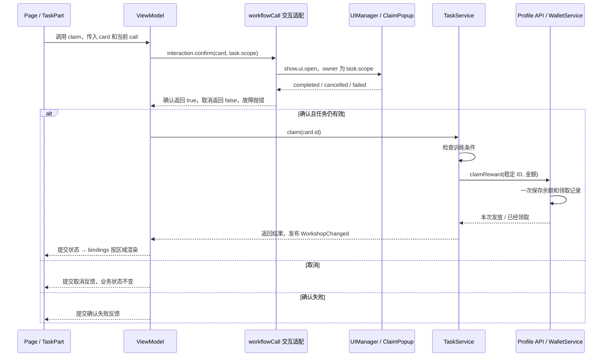

# 正式开发工作流

> 本文的示例源码可用于理解职责、调用和生命周期；涉及 Creator 工作台创建、自动绑定和预览的步骤是历史流程。当前可执行操作及限制见 [PinK 工作流](pink-workflow.md)。清理示例后源码链接将不再可用，请以框架类型、API 指南及当前业务实现为准。

先运行 `assets/game/boot/Bootstrap.scene`，选择“正式业务流程 · 任务奖励”，再按本文的源码链接查看实际实现。**YZForge → 项目工作台** 提供创建、自动绑定和配置表等编辑工具。本文的任务、训练、金币都是示例业务；框架本身不要求这些概念。

## 1. 从职责开始

这个示例把任务规则放在 `workshop`，账号余额放在 `profile`，公共配置放在 `common`。`showcase` 负责功能导航和实验。不要按每一个按钮拆模块；共享状态与发布边界才是拆分依据。

| 层         | 真实文件                                                                                                         | 负责什么                                         |
| ---------- | ---------------------------------------------------------------------------------------------------------------- | ------------------------------------------------ |
| 示例入口   | [ShowcasePage.ts](../assets/game/modules/showcase/code/ui/showcase-page/ShowcasePage.ts)                         | 通过 show.ui 调用类型化页面 Key，不传导航对象    |
| 模块装配   | [WorkshopModule.ts](../assets/game/modules/workshop/code/WorkshopModule.ts)                                      | 注入声明的 Profile API，创建 TaskService         |
| 业务规则   | [TaskService.ts](../assets/game/modules/workshop/code/services/TaskService.ts)                                   | 训练进度、配置查询、领取条件、业务事件           |
| 账号状态   | [WalletService.ts](../assets/game/modules/profile/code/services/WalletService.ts)                                | 余额、领取去重记录、存档和订阅                   |
| 展示流程   | [WorkflowPageViewModel.ts](../assets/game/modules/workshop/code/presentation/WorkflowPageViewModel.ts)           | 取数、确认、命令、反馈；暴露只读语义状态         |
| 页面显示   | [WorkflowPage.ts](../assets/game/modules/workshop/code/ui/workflow-page/WorkflowPage.ts)                         | 按钮绑定、动态 Part 创建、同步更新节点           |
| 交互适配   | [workflow.ts](../assets/game/modules/workshop/code/presentation/workflow.ts)                                     | 组合模型依赖，将当前显示的 UI 调用适配为确认端口 |
| 可复用部件 | [TaskPart.ts](../assets/game/modules/workshop/code/components/task-part/TaskPart.ts)                             | 将卡片数据和当前交互绑定到领取 Command           |
| 自动绑定   | [WorkflowPageBinding.ts](../assets/game/modules/workshop/code/ui/workflow-page/generated/WorkflowPageBinding.ts) | 节点引用和类型化 getter，由工作台生成            |

`game/app` 负责启动接入和应用装配，`start-game.ts` 只选择首屏及需要启动持有的模块。业务代码都留在所属模块：Service 管规则和状态，Page / Part 管显示，ViewModel 按需协调复杂交互。跨模块使用公开合同和 API；需要多步业务协调时，普通函数或类也放在发起业务的模块内。



调用期限结束时按任务取消处理，过期任务不再提交反馈或领取奖励；详见本文的使用期限约定。

**不要求每个简单页面都有 ViewModel。** 只有打开提示、显示时间等局部操作时，页面直接使用上下文更清楚。涉及多步交互、多个领域服务、复杂状态和单元测试时，引入 ViewModel；不要给 Service 传入 Label、Node 或页面实例。

| 当前需求                         | 最小实现与使用期限                                                       |
| -------------------------------- | ------------------------------------------------------------------------ |
| 静态文案、确认或一次局部操作     | Page / Part 直接使用参数和当前 show / activation                         |
| 仅本次显示需要的选择或筛选       | onShow 内创建 State，绑定跟随 show 结束                                  |
| 导航返回后保留选择、多步异步交互 | `show.session.use(factory)` 创建普通 ViewModel；每次操作传入当前交互端口 |
| 跨页面共享的余额、任务或账号状态 | 模块 Service 持有状态；会话流程显式持有模块                              |

先按实际使用期选择这一层级，再增加 Command、派生状态或 Part；无需为每个按钮建立完整的分层文件。

## 2. 在工作台创建内容

1. 创建自己的模块，选择代码交付方式和默认资源包。示例 `workshop` 使用按需代码，`profile` 使用启动代码，`common` 仅有配置和资源。
2. 创建 Page，复杂页面勾选 ViewModel；创建 Part 和 Service。首屏或需要跨模块打开的界面勾选“公开界面合同”，其余默认内部。先检查全部文件预览，脚本和预制体后缀自动补齐。
3. 在模块设置声明业务依赖。示例声明 `profile`，生成的依赖合同让模块工厂获得完整类型。
4. 通过生成的公开合同访问其他模块；不导入其他模块 `code` 里的具体服务或组件。

代码已加载和业务实例已创建是两回事。资源页读取 `TasksTable` 时只加载 JSON；第一次进入任务页时才加载 `code-workshop` 并创建任务业务。退出后业务持有归零可以销毁，代码通常仍由引擎保留。

## 3. 配置表先确定合同

[tasks.xlsx](../config-source/workshop/tasks.xlsx) 展示任务数据：`id:int`、`name:string`、`goal:int`、`reward:int`、`quality:enum<Quality>`、`economy:ref<common.economy>`。`__config` 声明导出包、主键、品质索引和正数约束；`__enums` 声明 Normal / Rare。

[samples.xlsx](../config-source/showcase/samples.xlsx) 补充 bool、float、数组、vec2、color、可空值、日期格式约束和 SpriteFrame 资源引用。`pack` 字段把 101 行导出到默认包、201 行导出到 extra 包。`Calculation` 工作表通过两条公式计算权重 1.5 / 2.5。

含公式的表修改后，需要在工作台执行“重新计算公式”，再正式导出。当前公式适配器使用 Windows 桌面 Excel，在副本上计算，不保存用户当前打开的 Excel 会话。已验证的公式结果位于 `project-settings/snapshots/formulas`，与源码一同复制；未改变输入时，读取这些结果不需要本机再次运行 Excel。源表或声明的关联输入改变会使旧结果失效。

完整字段类型、导出规则和公式命令见 [XLSX 配置表制作](config-tables.md)。

```ts
// 公开合同可以跨模块导入；import 本身不会加载 JSON 或创建业务服务。
const tables = await show.config.loadMany({ tasks: TasksTable, economy: EconomyTable });
const task = tables.tasks.require(1);
const economy = tables.economy.require(task.economy);

// 一张表有多个分片时必须选定 Bundle，禁止隐式合并或猜测。
const samples = await show.config.load(SamplesTable, { bundle: ShowcaseBundles.extra });
```

动态资源放在 `bundles/<包>/dynamic` 自动生成资源 Key；静态引用放在同一包的 `static`，两者一起属于 Bundle。加载一个资源会加载它的必要依赖；下载/解压整包与加载某一资源到内存的成本不同，不能仅凭 API 次数估计流量。

## 4. 先写 Service，再写展示流程

`TaskService.train()` 先保存，再更新状态和发布事实。`claim()` 在 Service 内再次检查训练次数；按钮禁用只是显示行为，不能代替规则检查。

`WalletService.claimReward()` 用稳定的 `workshop/task/<id>` 去重，并把余额和领取记录放在同一次存档写入中。写入失败不会改变内存状态；重试不会重复增加余额。这是本地示例，联网项目应由服务端权威处理经济结算，不能把客户端记录作为防作弊依据。

`WorkflowPageViewModel` 由 `show.session.use(createWorkflow)` 在一次页面会话中创建。导航挂起后返回保留选择，真正关闭后重新打开创建新模型。工厂显式传入 TaskService 和会话期限；每次调用再传入当前显示的确认端口。模型不依赖节点或 UIManager 的返回协议，业务测试无需启动 Cocos。卡片页与紧凑页复用同一个工厂。

Service 和 ViewModel 对外统一暴露 `ReadonlyState<T>`。`TaskService.state` 显式派生自训练进度与 `ProfileApi.state`；其他模块改变余额或领取记录，所有皮肤同步更新。领域事件用于记录已经发生的事实，界面当前值直接来自状态；不再由每个页面拼装订阅和手动 refresh。

## 5. 预制体与渲染

在 Creator 编辑预制体，命名节点：`btn_train`、`lbl_output`、`node_items`；在工作台“自动绑定”选择对应界面并扫描。生成文件可覆盖，手写 Page / Part 不会被生成覆盖。

原生前缀会识别实际挂载的项目子类，例如 `btn_submit` 挂 AsyncButton 后可直接调用 `this.btnSubmit.run(...)`。普通自定义组件使用 `comp_`；多个匹配组件按 Inspector 顺序取第一个。完整规则见[自动绑定](auto-binding.md)。

页面用框架 `onShow(show)`、`onHide()` 等钩子；Part 用 `onActivate(activation)` 等钩子。业务不覆盖 `onLoad/start/update/onDestroy`。动态 Part 先用 `{ active: false }` 创建，传入模型和回调后调用 `show.assets.activate(node)`。

`render()` 只同步写节点。异步取数后通过捕获的 `show.commit()` / `task.commit()` 提交，阻止旧展示覆盖新展示。一次 show 的资源、监听和任务都使用它自己的 Scope；长期账号任务才由账号会话持有。

资源使用期还要区分“操作期间”和“显示期间”。资源页的批量读取只生成文字快照，用 `show.config.in(task.scope).loadMany(...)`，操作结束就归还本批持有；反复点击不会在页面内堆积配置 Scope。动态 Part 则要在创建操作完成后继续显示，仍用 `show.assets.instantiate(...)`；创建与销毁共用 `exclusive('part-toggle')`，避免慢加载时连点创建多份实例。

## 6. UI 与模块怎样通信

| 需求                 | 采用方式                            | 示例                                      |
| -------------------- | ----------------------------------- | ----------------------------------------- |
| 页面给弹窗传信息     | ViewKey 的类型化参数                | 标题、奖励说明                            |
| 弹窗返回选择         | `handle.result` 的状态联合          | 确认才执行命令；取消没有成功值            |
| Part 通知父对象      | 明确的回调与 ID                     | `claim(taskId)`                           |
| 跨模块命令和查询     | 声明依赖 + 公开 API                 | TaskService 调用 ProfileApi               |
| 多处观察已发生的事实 | 类型化事件 + 所有者                 | `WorkshopChanged` 更新首页观察记录        |
| 页面切换             | `show.ui.pushPage` / `show.ui.back` | 启动会话持有新页面，不用即将挂起的旧 show |

不把事件当作需要返回值的隐式 RPC，也不通过查找另一个页面节点进行通信。Popup 默认阻挡下层输入；Overlay/Toast 的策略独立；Part 不进入 UI 页面栈。缓存只复用节点，每次显示仍有新的 showId 和 Scope。

页面调用 `await show.ui.pushPage(Key, 参数)` 只等本次切换，成功返回 `{ status: 'opened' }`；已有导航准备中时返回 `{ status: 'ignored', reason: 'busy' }`。原页面在目标就绪前保持显示；准备失败不改变页面栈，可以重试。准备期间返回只撤销该次前进；旧 show 结束后不能继续发起跳转。`onShow` 负责准备界面，导航从页面可交互后的回调发起。

同模块的完整界面 Key 从 `code/generated/views.ts` 导入；其他模块和启动入口只从目标模块的 `public.ts` 导入明确公开项。`ViewKey` 同时携带参数、结果和层级类型；Page 走 `pushPage`，Popup / Overlay / Toast / Loading 走 `open`。模块边界检查拒绝跨模块导入私有代码；这是源码约束，不是安全鉴权机制。

调试数据显示通过 `this.ctx.diagnostics.snapshot()` / `.module(id)` 读取，只返回只读摘要，不负责导航，不启动业务模块。

## 7. 状态、准备、取消与换皮

### 日常开发的默认流程

1. Service 负责规则、共享事实、配置、存档和网络；公开 `ReadonlyState<T>` 与业务方法。跨模块只使用对方的 `public.ts`。
2. 有选择、筛选或多步交互时，使用普通 ViewModel。只保存局部状态，用 `derive` 组合 Service 状态，用 `Command` 定义异步操作。
3. 在独立工厂中明确传入依赖。页面用 `show.session.use(factory)` 获取本次会话的模型。
4. View / Part 负责节点、排版、输入和资源；每次显示重新注册绑定。需要什么数据才能显示，由 `await model.start()` 和必需区域绑定明确表达。

静态确认框直接使用参数和 `show.finish`。只有短暂的局部显示值时可在 onShow 创建 State；需要在导航返回后保留的状态放进页面会话。复杂界面按独立区域组合普通模型与 Part，仍使用同一套状态、操作和期限规则。

以下是任务页的实际用法，`createWorkflow` 和 `workflowCall` 位于模块的 `code/presentation/workflow.ts`：

```ts
const model = show.session.use(createWorkflow);
await model.start(); // 本页的任务规则是必需数据
show.bindings.text(this.lblOutput, model.state,
    state => `余额 ${state.coins} 金币 · 训练 ${state.progress} 次`);
show.bindings.command(this.btnClaim, model.claim, model.state, {
    args: state => state.cards.find(card => card.id === state.selectedId)!,
    enabled: state => state.cards.some(card => card.id === state.selectedId && card.state === 'ready'),
    call: workflowCall(show),
});
```

工厂只同步创建和组合模型。`session.use` 不隐式加载所有远程数据。任务规则缺失时可以阻止本页打开；商城推荐、排行榜头像等独立内容可先显示占位，使用 `prepare({ required: false })` 在本区加载与反馈错误。首次必需准备失败使打开失败并保留原页，可选区域失败只影响本区。

### 动态 Part、集合与列表

页面使用 `show.bindings`，静态 Part 使用 `activation.bindings`，组合条目使用 `item.bindings`；三者提供相同的文本、属性、事件、命令与资源准备能力。

```ts
show.bindings.items(this.nodeItems, model.state, state => state.cards, {
    key: card => card.id,
    prefab: WorkshopRes.prefab.prefabsTaskPart,
    part: TaskPart,
    bind: (part, item) => part.bind(item, model.claim, workflowCall(show)),
});
```

单个区域使用 `part(container, source, select, options)`，选择结果为 undefined 时清空。普通集合使用 items；大量数据使用 list 和 VirtualList。三者的业务条目统一使用 `PartContext<T>`：`key` 表示身份，`state` 提供 `{ data, index }` 的只读状态，`bindings` 管显示和输入，`assets` 管资源，`scope/run` 管当前身份的工作。

普通集合的容器须为空且已加入节点树，由这一组合独占直接子节点。相同 Key 和相同 Prefab/Part 类型保留节点、订阅和绑定，只更新数据与必要顺序。新增项先准备；准备失败保留整个旧集合，连被保留条目的数据也不会提前更新。成功交接后才清理移除项。旧候选或移除项仍在清理时，新的实例创建等待其真实结束，避免不断创建补位节点。每个组合固定一种 Prefab/Part，换类型需要结束旧组合后重新挂载。

Part 在 bind 中注册 text/property/command；同 ID 的更新通过 item.state 推送，禁止保存一次初始快照后期待 bind 再次执行。数据更新不会取消该身份下的全部工作；需要随参数替换的请求放进 prepare 或 Command.latest。列表滚动后的选择和编辑草稿由外部模型保留。

`part/items/list` 默认参与页面或组件首绘屏障；可选区域显式设置 required:false 并提供 onError。ready 等待最新必需内容，也覆盖同 ID 数据更新触发的资源准备。等待期间，条目内部、嵌套 Part 和组件激活绑定的新准备会逐层传递，外层数组不变也会重新核对；虚拟列表只要求当前窗口。可选区域不阻挡父级，直接等待它自己的 ready 仍会等待本区必需资源。part/items 的 refresh 重试尚未提交的集合候选，保留已有条目；已显示条目的资源错误用对应 prepare/present 句柄重试。虚拟列表的 refresh 则完整重建指定身份绑定。dispose 同步撤销该区域的首绘要求和输入，完整清理后才能复用其容器。首次失败、后续准备失败与同步渲染缺陷分别处理。详见[虚拟列表](virtual-list.md)。

### 四种使用期限

| 所有者                            | 存放内容                                     | 结束时机                 |
| --------------------------------- | -------------------------------------------- | ------------------------ |
| 模块 / 外部业务会话               | 共享事实、业务 Service、需要后台继续的工作   | 模块或业务会话结束       |
| `show.session.scope`              | 页面 ViewModel、选择、筛选、页面级数据准备   | 真正关闭；导航挂起仍保留 |
| `show.scope` / `activation.scope` | 输入、状态订阅、显示绑定、本次显示发起的交互 | 隐藏、挂起或关闭         |
| 实例期限                          | 缓存节点与组件实例                           | 节点最终销毁             |

一次页面打开固定参数。导航返回仍为同一会话，但 showId、show.scope、show.ui 和显示绑定全部更新。真正关闭再打开时，即使复用缓存节点，也创建新会话并使用新参数。模型不能保存某一轮 show、show.ui 或节点。需要弹窗时，调用的 context 提供本次显示的语义端口；例中的 `confirm(card, owner): Promise<boolean>` 以 false 表达取消，以抛错表达故障，适配器负责把 UI 的结果协议转换过来。

### 一致的只读状态与派生

```ts
const selected = new State<number | undefined>(undefined);
const selectedCard = derive(owner, [service.state, selected.readonly],
    (facts, id) => facts.cards.find(card => card.id === id));
```

State 只接收普通数据，复制并冻结新分支。状态与命令参数不保存节点、资源、服务或函数。`derive` 在定义时显式列出依赖，只接受框架 State / derive；计算只读传入快照，必须纯同步，禁止写状态、读取未声明状态或返回 Promise。所有相关派生完成后才通知 View，菱形依赖不会发布新旧分支混合的中间状态。

`batch(() => { ... })` 同步合并相关写入的通知，嵌套在最外层结束刷新。批内和观察者重入期间对同一状态的待通知写入合并为最新值。batch 不是事务，抛错不会撤销已写入的数据。钱包与奖励记录等业务一致性必须由 Service 的提交协议保证。

默认相等比较为 Object.is；派生集合可显式提供 equals，相等时保留旧快照身份。计算初次失败直接抛给创建方；后续失败停止受影响的派生和下游，读取抛错，并向错误通道报告，重新创建才恢复。计算错误代表模型缺陷；可预期的网络失败应由 Command 转成语义反馈。owner 结束时释放依赖和订阅，最后快照仍可读取。普通观察者失败会被移除并单独上报，不影响 Service 已完成的提交。

### 受管操作与每次调用

操作定义在模型内固定策略和容量，多个按钮只借用定义：

```ts
const save = new Command(owner, {
    policy: 'exclusive',
    execute: async (input: Readonly<{ id: number }>, task) => {
        const result = await service.save(input.id, task.signal);
        task.commit(() => feedback.set(result));
    },
});
const invocation = save.invoke({ id }, { owner: show.scope, context: undefined });
if (invocation) await invocation.result;
```

| 协议                   | 规则                                                                      |
| ---------------------- | ------------------------------------------------------------------------- |
| 参数                   | 点击 / invoke 时复制冻结；等待确认期间切换选择不会改变本次目标            |
| `exclusive`            | 同一 key 从准入到实际清理结束都互斥，重复返回 undefined                   |
| `latest`               | 替换旧结果与后续提交；旧工作仍实际退出，计入汇总 cleaning                 |
| `serial`               | 每个 key 有固定容量，包含执行和清理；结果尽早交付，下一项等待前项实际清理 |
| key                    | 默认整个操作；需要逐个商品 / 邮件独立执行时显式提供稳定业务 ID            |
| `result`               | 本次业务结果、错误或取消；不等待清理，也不被清理错误替换                  |
| `completed`            | 本次工作与清理实际结束；清理错误单独拒绝并报告                            |
| `command.state`        | queued、running、cleaning、pending、busy；来自调度器，无需模型另设 busy   |
| `command.canRun(args)` | 当前参数对应的准入；内部先解锁再发布空闲，观察者可以立即重试              |

取消只停止等待和后续展示提交。已提交的服务端请求仍须由业务会话处理结果、幂等和对账；不能因为页面关闭就丢弃已经发生的业务事实。确认弹窗失败时页面可以先显示“失败，正在清理”，按钮由 Command 保持禁用，真正清理完成才恢复。`Actions` 是动态命名工作的便捷入口，与 Command 共用调度机制；稳定业务操作使用 Command。

### 渲染、属性所有权和资源

`text` / `property` 只在选中值变化时写入。`command` 同时管理按钮可交互属性和点击转发。一个受管属性只能有一个写入者，重复注册抛出 `BINDING_PROPERTY_OWNED`；手写 watch 可用 `writes: [[label, 'string']]` 声明所有权。普通直接赋值不会被拦截，业务代码仍须遵守同一规则。

多语言绑定参与相同的属性所有权检查，重绑前显式 dispose 旧绑定。AsyncButton 自己管理 interactable；使用模型 Command 的页面优先用原生 Button 加 command 绑定，避免同时启用自动防连点绑定。只解绑一个按钮不关闭共享 Command，也不取消其他界面的调用；本次调用由 call.owner 管理。

```ts
show.bindings.prepare(model.state, state => state.itemIds, {
    label: 'items',
    required: false, // 本区可先显示占位；默认 true 时加入整页首绘屏障
    prepare: async (ids, stage) => {
        const assets = show.assets.in(stage.scope);
        return await prepareItems(ids, assets, stage.signal);
    },
    render: (next, _ids, previous) => replaceItems(next, previous),
    onError: error => showRegionFailure(error),
});
```

候选资源由 stage.scope 持有，只有最新代次可以同步交接；旧资源在新内容显示成功后才释放。取消先阻止回写，再等待工作实际退出。不要在 prepare 中等待自己的 dispose，也不要用 Command 的短期 Scope 持有操作结束后还要显示的节点。UIView 在 onShow 和组件准备后核对必需绑定；选择器及同步 render 错误进入宿主故障通道。后续 prepare 失败保留旧内容，用返回句柄的 refresh() 重试；准备失败通过 onError 反馈，省略时记录错误，不进入同步渲染缺陷的宿主故障通道。可选区域应自行显示占位、错误和重试入口。

有资源准备的详情区域可以使用 `present`：它遵循 prepare 的规则，额外返回 `state: ReadonlyState<{ ready:false } | { ready:true; value:T }>`。画面成功交接后才发布 value；按钮从此状态捕获参数，避免源状态已切到 B、画面仍是 A 时操作 B。首次 ready:false 时禁用输入；Service 仍根据最新业务事实校验提交。present 的选择结果必须是纯数据，资源放在 prepare 的返回值中。

两个换皮界面默认各有页面会话和局部选择，共享 Service 和模型实现。确需共用同一模型实例时，由明确的外部业务会话持有，每次调用仍传入当前显示端口，每个 View 独立绑定资源。布局一致只替换图片或字体，布局不同则使用各自 View / Prefab。同一逻辑 ViewKey 的皮肤在 App 创建前选择 Prefab；同时显示两套布局使用不同 Key。

大量列表使用 VirtualList、稳定 ID 和条目级更新；卡片状态变化不重建节点。每帧坐标、粒子和动画保留在 onTick 中。规范约束的是状态、所有权、操作和错误协议，不要求每个小弹窗建立所有层。

## 8. 验证与发布

```powershell
npm run verify
npm run test:showcase
npm run test:integration -- presentation ui --url http://localhost:7456/
```

构建前除 TypeScript 和生成一致性检查外，还检查 Creator 是否已注册每个 UI 的组件类；有缺失导入时先修复、刷新脚本并等编辑器完成编译，不能仅凭 tsc 通过就发布。

在 Creator 中运行 Bootstrap，逐个操作实验按钮。按 [游戏设置与 SDK](game-settings-sdk.md#构建与预览模拟) 保存场景并导出构建参数，构建 Web 后可运行真实运行时集成检查：

```powershell
node tests/integration/serve-build.mjs build/verify-showcase-web
# 另一个终端，填写服务输出的实际端口；需要连接当前项目的 Cocos MCP。
node tests/integration/verify-showcase.mjs http://127.0.0.1:实际端口/
```

示例集成检查使用独立窗口和临时浏览器会话，不使用玩家已有存档。覆盖按钮输入、弹窗返回、资源路由、业务回收和页面反复进出；截图帮助检查屏幕适配。小游戏构建检查不能代替微信真机验证，Web 验证也不能代替原生设备验证。完整入口和覆盖范围见 [功能展示](showcase.md)。
